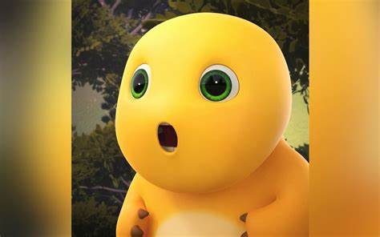
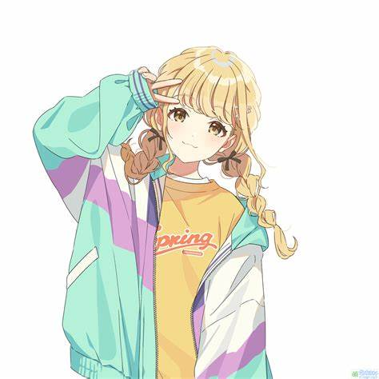

# Identificación de Nailong
Un modelo de deep learning para identificar Nailong con gran precisión.

Este modelo alcanza una precisión superior al **98 %** y puede distinguir de forma fiable entre **Nailong** y **Konote Fujita** (¡y cualquier otro objeto!).

## Demostración
<table>
  <tr>
    <td align="center">
       
      
<b>Nailong</b>

    </td>
    <td align="center">
       
      
<b>Konote Fujita</b>

    </td>
  </tr>
</table>

### ¡Solo por diversión!
Mira el vídeo de demostración en Bilibili: [Vídeo de demostración](https://www.bilibili.com/video/BV18gDdY3EV6/) (en chino).

## Modelo
- **Red neuronal:** VGG11
- **Visualización del entrenamiento:** Incluye gráficos de pérdida y precisión. [Pérdida y precisión](model/results/VGG11-Nailong_plot.png)

## Dataset
Descarga el dataset desde: [Dataset de Nailong en HuggingFace](https://huggingface.co/datasets/XiC1/nailong-dataset)

## Música e inspiración
Inspirado en el siguiente vídeo de Douyin y con música de: [Vídeo de Douyin](https://www.douyin.com/video/7433341884916862260)

## Requisitos del entorno
- Se requiere una **GPU** para el entrenamiento y la inferencia.
- Paquetes de Python necesarios: `Python3.x`, `os`, `torch`, `torchvision`, `PIL`, `matplotlib`, `tkinter`, `pygame`.

## Cómo utilizarlo
1. Descarga el repositorio completo del proyecto.
2. Asegúrate de que todas las dependencias del entorno estén instaladas.
3. Ejecuta `api.py` para iniciar la aplicación.
